<picture><source media="(prefers-color-scheme: dark)" srcset="art/banner-dark.png"></picture>

I build things for my own home: a self-hosted homelab, a custom smart-TV home screen and phone remote, a radio
station and a Discord bot that ties them together. Everything runs on one PC under my TV and is all on GitHub,
with every screen documented in each repo.

## Projects

<a href="https://github.com/ShaneRunham/Homelab"><picture><source media="(prefers-color-scheme: dark)" srcset="art/homelab-dark.png"></picture></a>

Docker on Fedora: Home Assistant with my own dashboard and **Hideout Map** (the homelab drawn as a city), Jellyfin, an
offline voice assistant, my own Git server with CI, and nightly snapshots to a mirrored pair of drives. Its health is
a **Wanted Level** of 0 to 5 stars that shows on every screen.

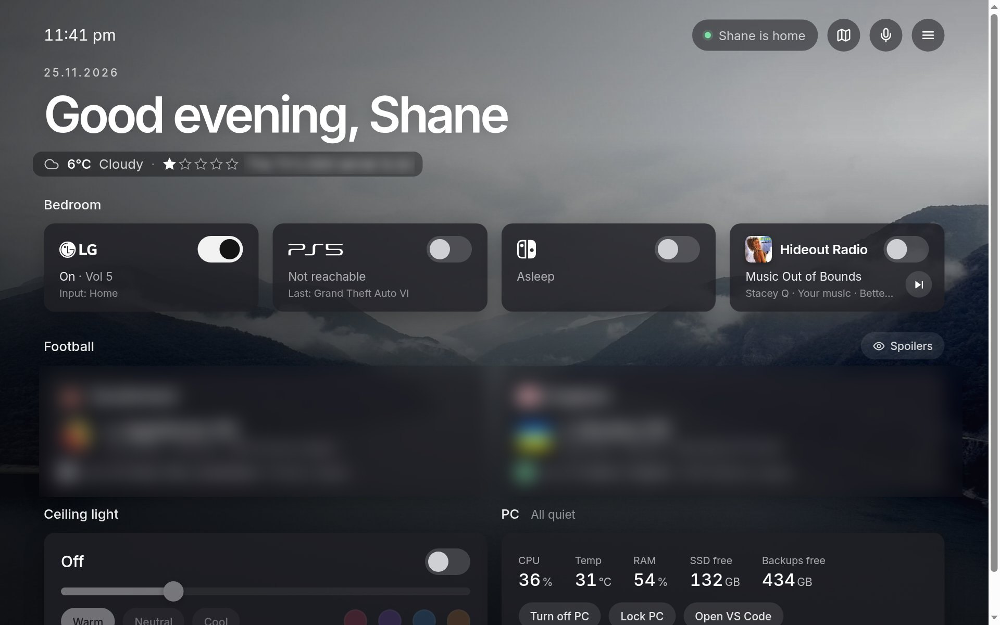 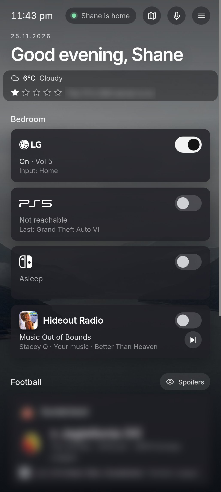

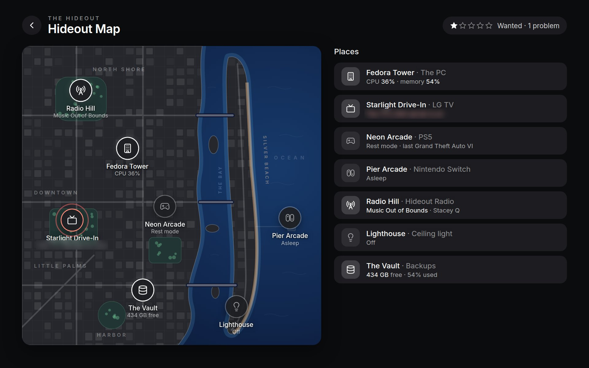 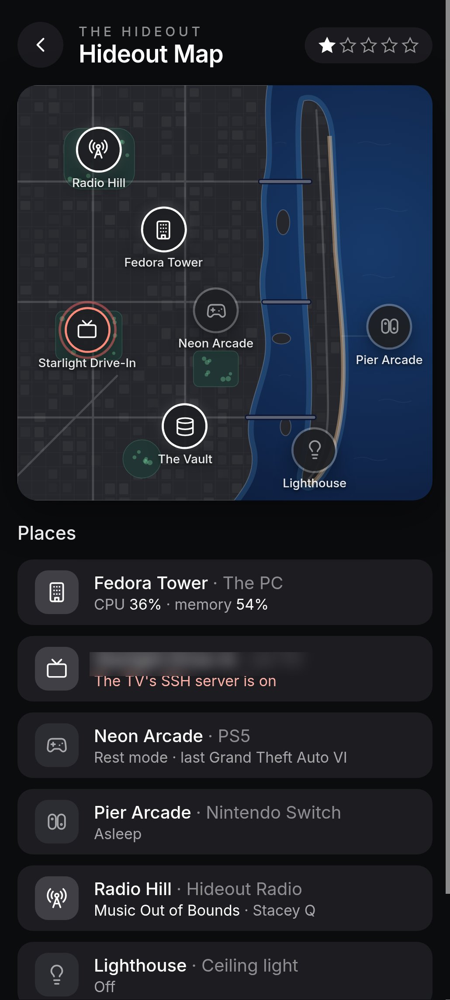

    

<a href="https://github.com/ShaneRunham/Hideout-Bot"><picture><source media="(prefers-color-scheme: dark)" srcset="art/hideout-bot-dark.png">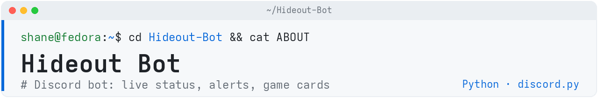</picture></a>

A Discord bot in Python. It keeps a live status card for the server, works out the Wanted Level and hands alerts to
Home Assistant, posts "playing now" cards for friends on PlayStation and Switch, follows GTA VI news and plays Hideout
Radio in a voice channel.

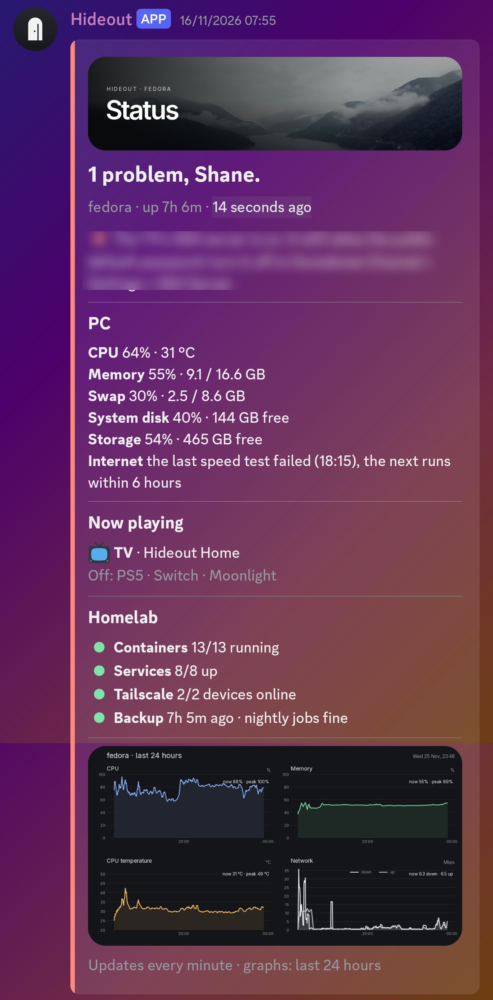 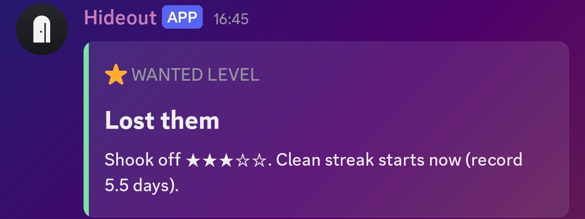

 

<a href="https://github.com/ShaneRunham/Hideout-Home"><picture><source media="(prefers-color-scheme: dark)" srcset="art/hideout-home-dark.png">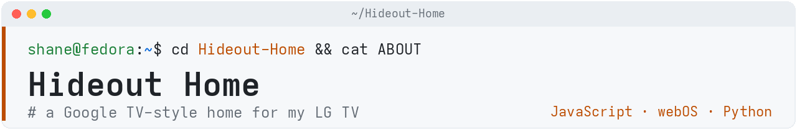</picture></a>

A Google TV-style home screen on my LG TV: a featured card for what I'm watching (it plays from Jellyfin), the next
match, the radio and the PS5, my apps, inputs and Continue watching, and on-screen cards over any app. **Hideout
Phone** is its remote: the same cards, a swipe pad, Ask, texting the TV, the devices, the radio and the Wanted Level.

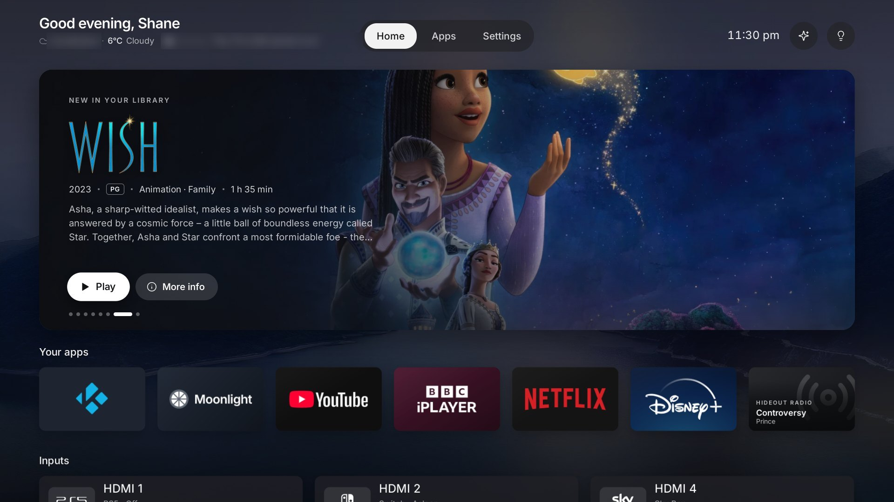

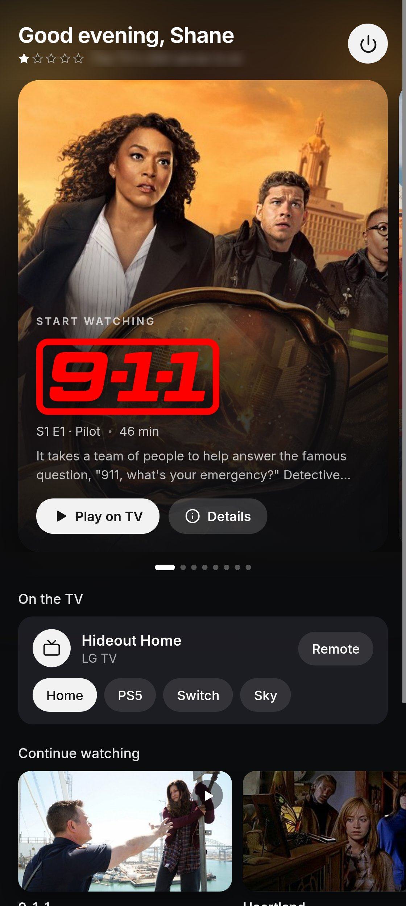 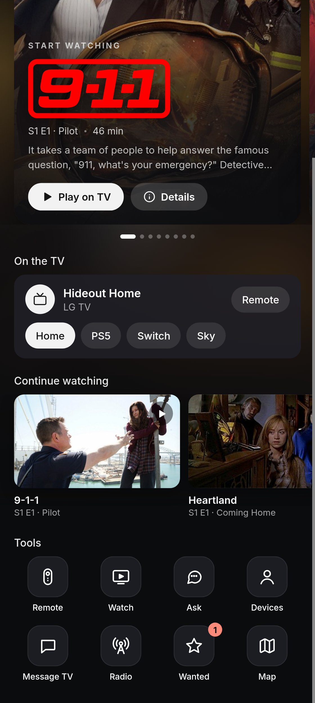 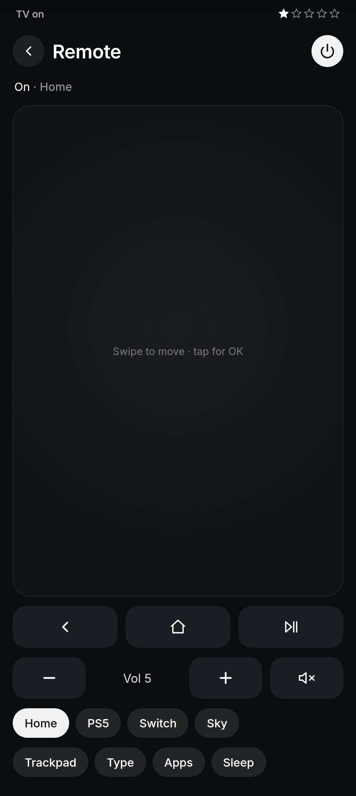 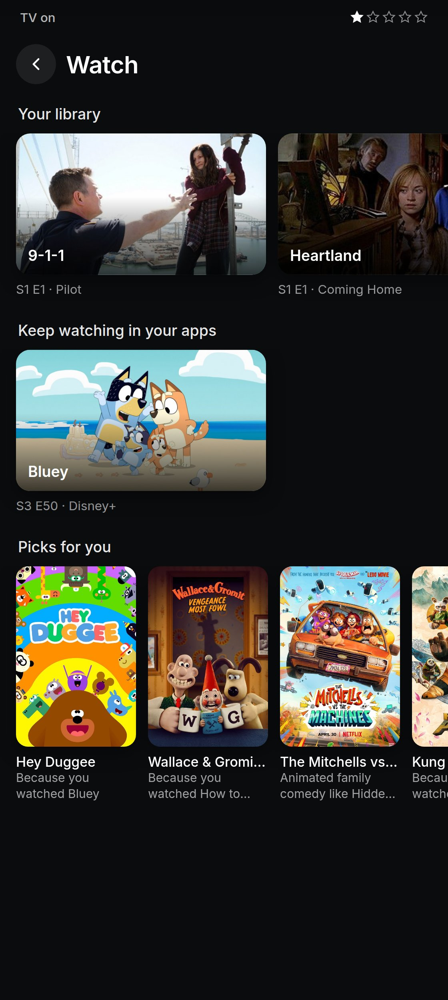 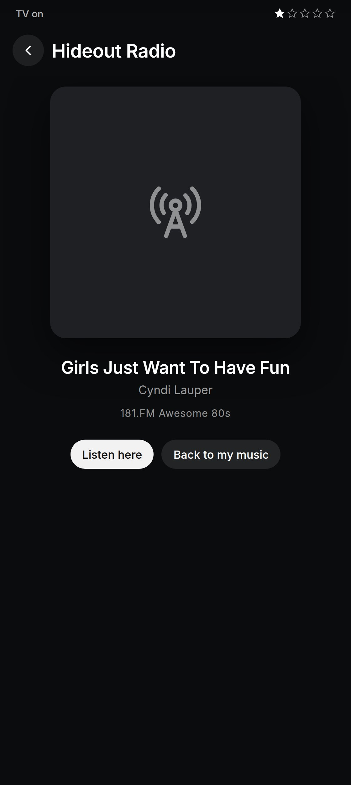

  

<a href="https://github.com/ShaneRunham/Hideout-Radio"><picture><source media="(prefers-color-scheme: dark)" srcset="art/hideout-radio-dark.png">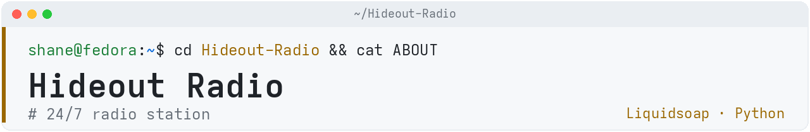</picture></a>

A 24/7 80s station on Liquidsoap: my own library shuffled, a block from an internet station every few songs, my
current favourites slotted in more often, every track loudness-matched, 6-second crossfades. It plays on the TV, the
phone, in Discord and anywhere on my network.

<picture><source media="(prefers-color-scheme: dark)" srcset="art/radio-now-dark.png">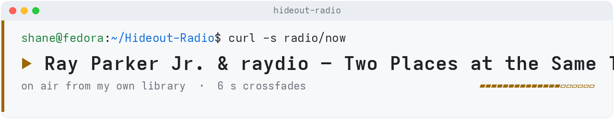</picture>

 

---

Public repos are cleaned copies of my private ones, updated on every commit. The full history lives on my own
Forgejo server, which is why most green squares are private contributions.
