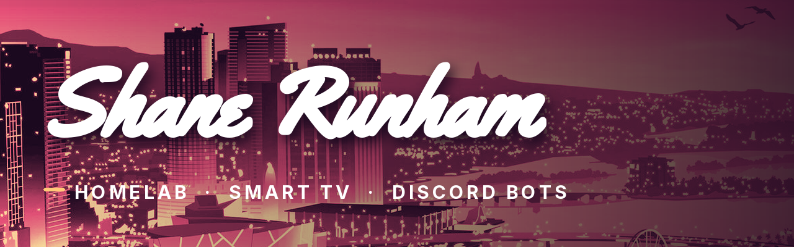
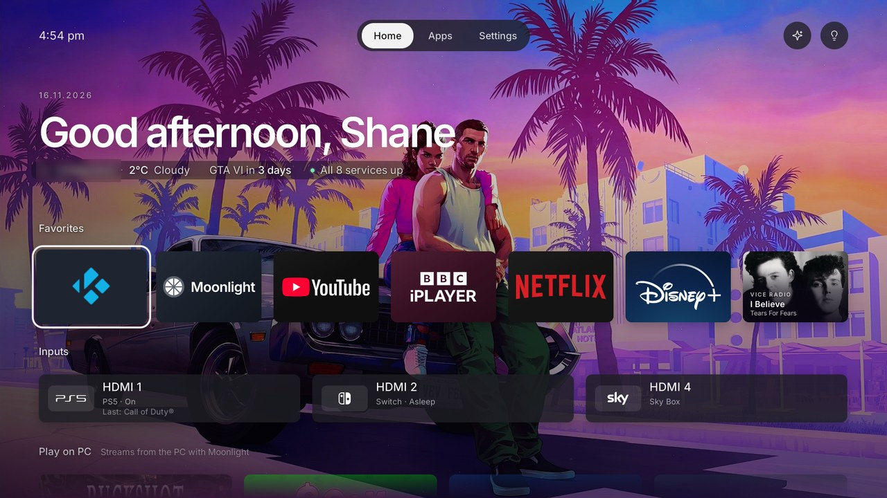
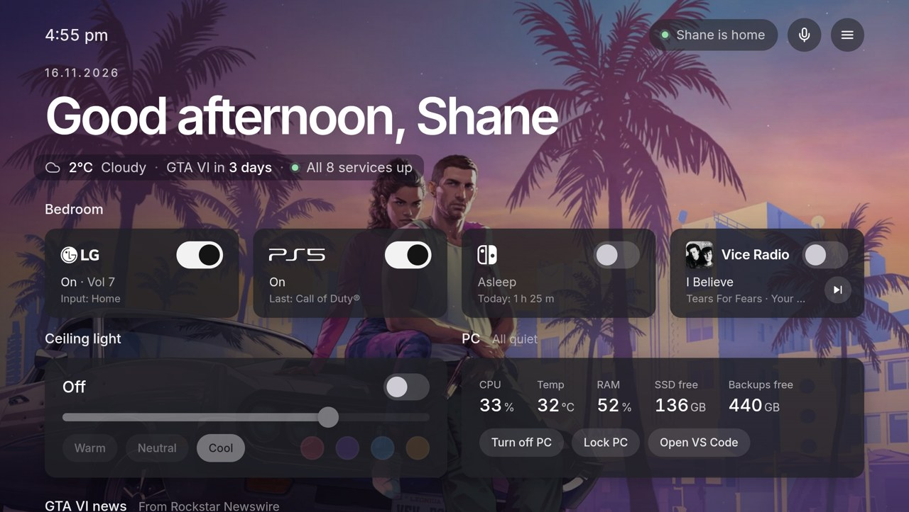
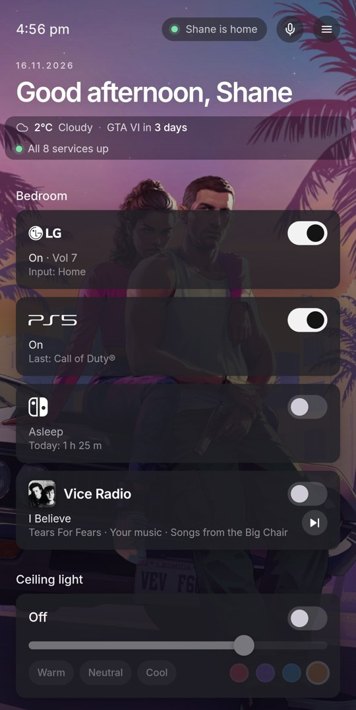
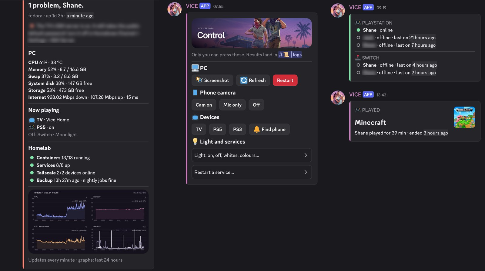

I build things for my own home: a self-hosted homelab, a custom smart-TV home screen and a Discord bot that ties
them together. Most of it lives on my own Git server, so the green squares below are private commits.

### What I'm working on

**📺 Vice Home** · a home screen for an LG webOS TV. It has live tiles for the PS5 and Switch, a radio, on-screen
cards for alerts and now-playing, and a phone remote. Built with JavaScript and a small Python service.

**🏠 Homelab** · Docker on Fedora: Home Assistant (with a custom dashboard panel), Jellyfin, Uptime Kuma,
Forgejo with CI, an offline voice assistant, and nightly btrfs snapshots to a mirrored drive.

 

**🤖 VICE** · a Discord bot in Python (discord.py). It posts a live server status card, alerts, "playing now" cards
for PlayStation and Nintendo Switch friends, and GTA VI news. It also streams **📻 Vice Radio**, a music
station running on Liquidsoap.

### Tools

